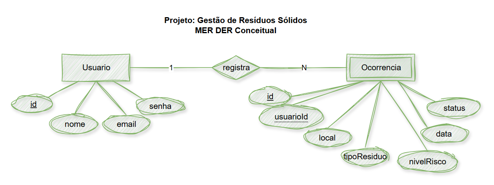
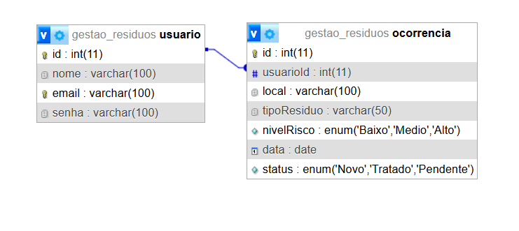
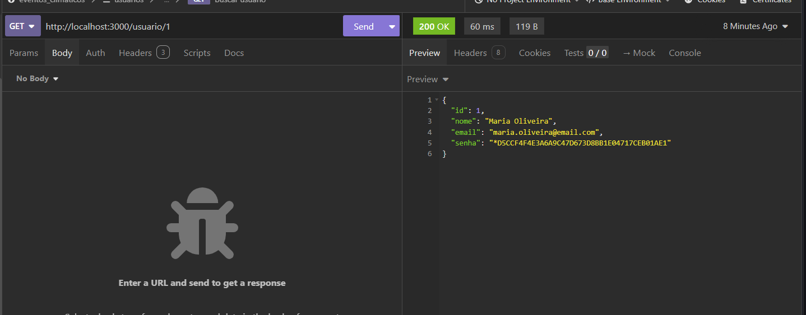
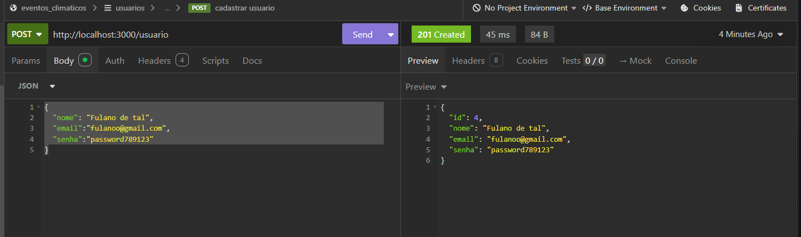
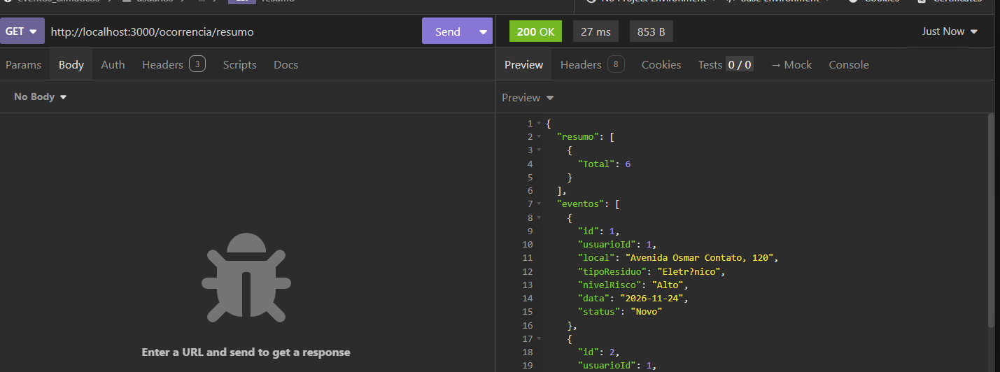
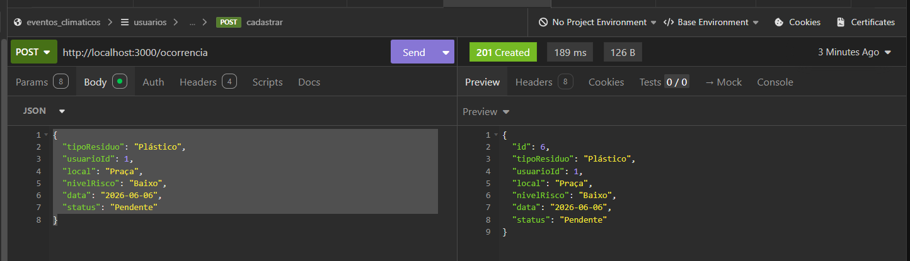
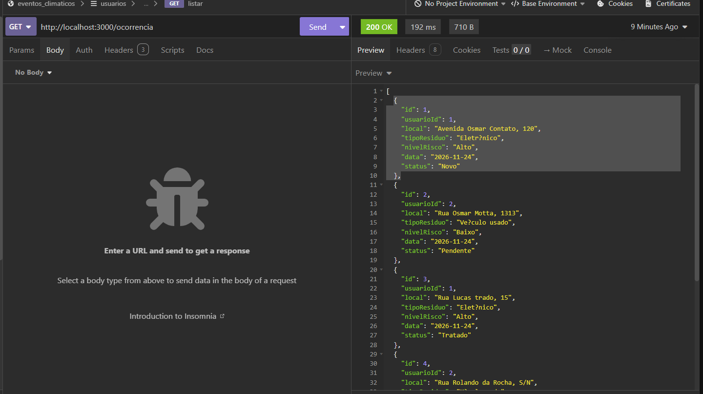
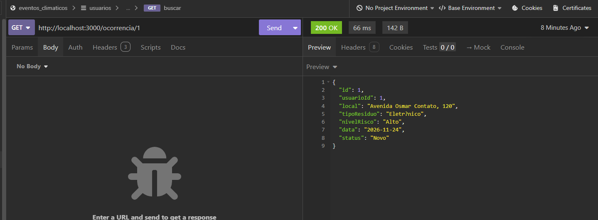
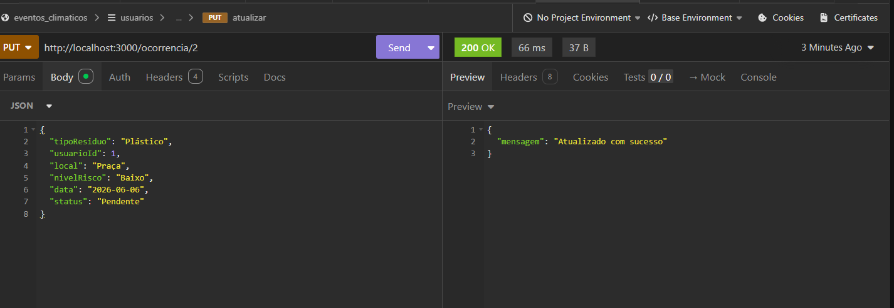
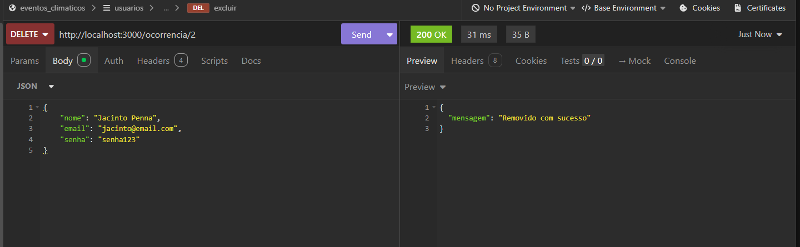

# Gestão de resíduos Sólidos

## Descrição
O projeto **Gestão de resíduos Sólidos** tem como objetivo gerenciar e monitorar a gestão de resíduos sólidos.

O sistema permite realizar o cadastro de usuários, registrar informações, consultar, atualizar e excluir registros e etc.

---

## Diagrama de Classes
<p align="left">
  
</p>
<p align="left">
  
</p>

---

## Tecnologias
* JavaScript
* Node.js
* Express
* MySQL
* MySQL2
* Insomnia

---

## Passo a passo para testar

### 1. Clonar o repositório
```bash
git clone URL_DO_REPOSITORIO
```

### 2. Acessar a pasta do projeto
```bash
cd NOME_DO_PROJETO
```

### 3. Instalar as dependências
```bash
npm install mysql2, express, cors
```

### 4. Configurar o banco de dados
* Abrir o MySQL.
* Executar o script SQL disponibilizado no projeto.
* O script criará o banco de dados `gestao_residuos`, as tabelas `usuario` e `ocorrencia` e inserirá dados para testes.

### 5. Iniciar o servidor
```bash
npm run dev
```

O servidor estará disponível em:
```text
http://localhost:3000
```

### 6. Testar a API no Insomnia
Utilizar o Insomnia para realizar requisições HTTP e testar as funcionalidades do sistema.

---

## Testes do Insomnia

## Testes Usuários
### Login Usuário
<p align="left">
  
</p>

### Listar Usuário
<p align="left">
  
</p>

### Buscar Usuário
<p align="left">
  
</p>

### Cadastrar Usuário
<p align="left">
  
</p>

### Atualizar Usuário
<p align="left">
  
</p>

### Excluir Usuário
<p align="left">
  
</p>

## Testes Ocorrências
### Login Ocorrência (Resumo)
<p align="left">
  
</p>

### Cadastrar Ocorrência
<p align="left">
  
</p>

### Listar Ocorrência
<p align="left">
  
</p>

### Buscar Ocorrência
<p align="left">
  
</p>

### Atualizar Ocorrência
<p align="left">
  
</p>

### Deletar Ocorrência
<p align="left">
  
</p>
```[cite: 1]

---

### 2. Projeto: `backend_energia`[cite: 2]


## Testes do Insomnia

## Testes Usuários
### Login Usuário
<p align="left">
  
</p>

### Listar Usuário
<p align="left">
  
</p>

### Buscar Usuário
<p align="left">
  
</p>

### Cadastrar Usuário
<p align="left">
  
</p>

### Atualizar Usuário
<p align="left">
  
</p>

### Deletar Usuário
<p align="left">
  
</p>

## Testes Consumo
### Resumo Consumo
<p align="left">
  
</p>

### Cadastrar Consumo
<p align="left">
  
</p>

### Listar Consumo
<p align="left">
  
</p>

### Buscar Consumo
<p align="left">
  
</p>

### Atualizar Consumo
<p align="left">
  
</p>

### Deletar Consumo
<p align="left">
  
</p>
```[cite: 2]

---

### 3. Projeto: `backend_usos_ia`[cite: 3]

## Testes do Insomnia

## Testes Usuários
### Login
<p align="left">
  
</p>

### Cadastrar Usuário
<p align="left">
  
</p>

### Listar Usuário
<p align="left">
  
</p>

### Buscar Usuário
<p align="left">
  
</p>

### Atualizar Usuário
<p align="left">
  
</p>

### Deletar Usuário
<p align="left">
  
</p>

## Testes Usos de IA
### Resumo Uso IA
<p align="left">
  
</p>

### Postar Uso IA
<p align="left">
  
</p>

### Listar Uso IA
<p align="left">
  
</p>

### Buscar Uso IA
<p align="left">
  
</p>

### Atualizar Uso IA
<p align="left">
  
</p>

### Deletar Uso IA
<p align="left">
  
</p>
